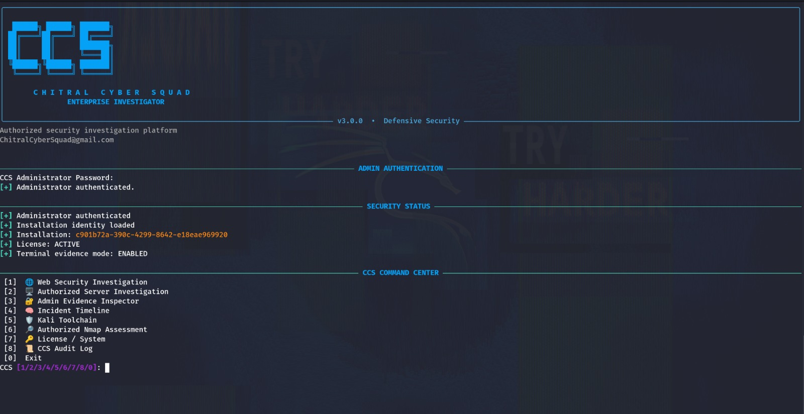

# CHITRAL CYBER SQUAD
## Enterprise Investigator v3.0.0

**Defensive Security, System Inspection and Incident Investigation**

Developed and maintained by **Zia Akbar**  
**Founder and Administrator — Chitral Cyber Squad**

Email: ChitralCyberSquad@gmail.com

---

## About the Project

CCS Enterprise Investigator is a Python-based terminal application designed to support authorized defensive security assessments, local system inspection, and incident investigation.

The application provides tools for reviewing DNS records, HTTP responses, security headers, system information, running processes, network connections, and selected publicly accessible resources.

It also includes local administrator authentication, audit logging, and SHA-256 hashing for inspected evidence.

## Features

- **Administrator Authentication:** Local password verification using PBKDF2-HMAC-SHA256.
- **Web Security Investigation:** Inspect HTTP responses and selected security headers.
- **DNS Intelligence:** Query common DNS record types.
- **Public File Exposure Checks:** Check selected paths for publicly accessible resources.
- **System Information:** Display platform, CPU, memory, and disk information.
- **Process Investigation:** Review running processes.
- **Network Inspection:** Display available network connection information.
- **Service Investigation:** Inspect supported services and systemd information.
- **Scheduled Task Inspection:** Review available cron and systemd timer information.
- **Audit Logging:** Record selected application and investigation events.
- **SHA-256 Evidence Hashing:** Calculate hashes for inspected response content.
- **Local Data Structure:** Maintain separate directories for cases and evidence.

Feature availability depends on the operating system, permissions, and network access.

## Screenshot

The following screenshot demonstrates the CCS Enterprise Investigator terminal interface.



Before publishing screenshots, remove installation identifiers, passwords, private information, and sensitive investigation data.

## Technology Stack

- Python 3
- Requests
- psutil
- dnspython
- Cryptography
- Rich

## Requirements

- Kali Linux or another compatible Python 3 environment
- Python 3 and pip
- Internet access for DNS and HTTP investigations
- Appropriate permissions for local system inspection

## Installation

### 1. Clone the Repository

Replace `YOUR_USERNAME` with your GitHub username.

```bash
git clone https://github.com/YOUR_USERNAME/ccs-enterprise-investigator.git
cd ccs-enterprise-investigator
```

### 2. Create a Virtual Environment

```bash
python3 -m venv .venv
source .venv/bin/activate
```

### 3. Install Dependencies

```bash
python -m pip install requests psutil dnspython cryptography rich
```

### 4. Run the Application

```bash
python ccs.py
```

On first launch, follow the prompts to create the local administrator password. Keep it private and store it securely.

## Security and Privacy

- Use the application only on systems and domains you own or are explicitly authorized to investigate.
- Obtain appropriate permission before testing third-party websites.
- Review requested resources and collected responses carefully.
- Never commit passwords, private configuration files, password hashes, salts, tokens, private keys, audit logs, cases, or evidence.
- Keep private investigation data outside the Git repository.
- Review screenshots and logs before sharing them publicly.
- Do not assume that a publicly accessible resource is safe to download, display, or redistribute.
- Local administrator authentication does not replace operating-system security controls.

## Important Warnings

This application is intended for educational and authorized defensive security work.

Public-file checks may request sensitive-looking paths. Use these checks only within an approved scope, and do not access, retain, or disclose information without authorization.

The included `LOCAL_DEVELOPMENT` license setting is a development placeholder, not a production license-verification service.

The application reports observations from its checks. It does not guarantee that a system is secure or insecure.

## Developer Information

**Name:** Zia Akbar  
**Role:** Founder and Administrator  
**Organization:** Chitral Cyber Squad  
**Email:** ChitralCyberSquad@gmail.com

### Mission

To promote cybersecurity awareness, responsible digital investigation, defensive security practices, and practical security education.

## License

No open-source license has been specified for this project. Unless the copyright holder adds a license, all rights are reserved. Viewing or cloning the repository does not automatically grant permission to redistribute or commercially use the code.

## Disclaimer

This project is provided for educational and authorized defensive security purposes. Users are responsible for obtaining permission and complying with applicable laws and policies. The developer and organization do not guarantee that the application is suitable for every environment or investigation.

---

**Copyright © Zia Akbar — Chitral Cyber Squad**
